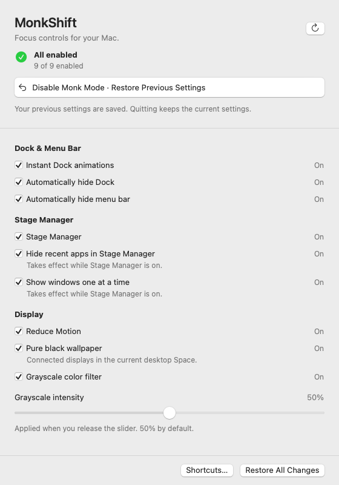
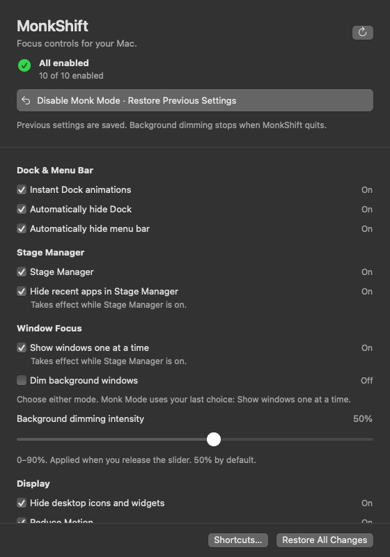
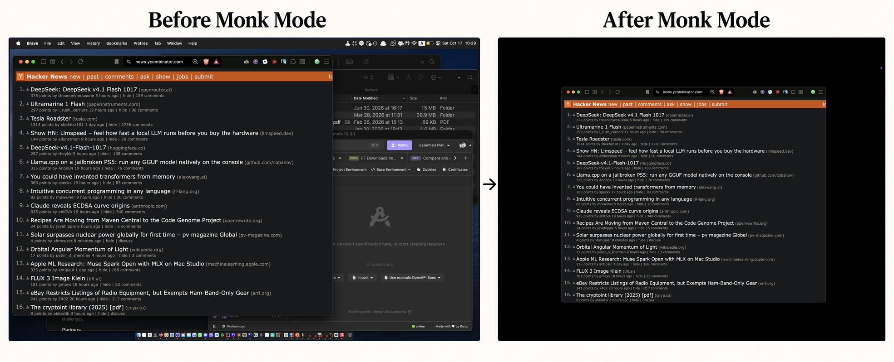
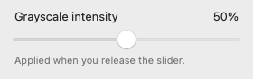
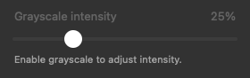
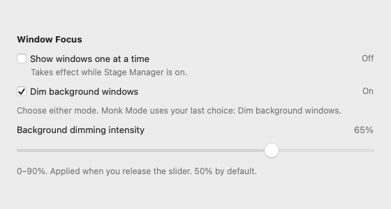
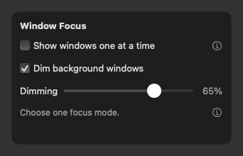
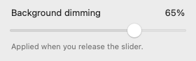
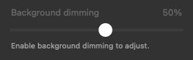

# MonkShift


A minimal native macOS focus utility built with SwiftUI and AppKit. macOS 14 or later. MIT licensed, fully offline, no dependencies, accounts, analytics, network clients, web views, or resident helper processes.

Monk Mode combines your chosen window-focus mode with Dock, menu bar, Stage
Manager and display preferences, then restores the previous settings when
disabled. Choose between showing one window at a time in Stage Manager and
dimming background windows with an independent intensity control up to 90%.
Settings are also available individually in the app window and menu bar.

<p>
  
  
</p>

Fixture previews of the real UI, rendered without changing system settings. They
show layout and example states, not proof of OS effects. [Automation onboarding](docs/images/permission-light.png).

## Philosophie

Attention is finite. What fills the screen also occupies the mind. MonkShift
reduces visual distractions so one application, and one task, can take the foreground.

Muted colors bring the screen closer to a newspaper than a glossy magazine.
The intention is simple: to make the computer feel like a tool for deliberate
work, with fewer invitations to consume and more room to think.



*Real desktop screenshots before and after Monk Mode.*

## Version 0.1.4

- Save named profiles and select them from the window or menu bar to apply
  their settings immediately. Default captures current settings; edits autosave.
- Toggle one-window mode with **Control + Option + Command + W** and dimming
  with **Control + Option + Command + D**. Both shortcuts are editable.
- One-window mode enables Stage Manager and Hide recent apps, restoring both
  earlier states when disabled or replaced with dimming.
- Known external preference changes and system events update observed status
  without periodic polling or replacing saved profiles and restore baselines.

See [.github/RELEASE_NOTES.md](.github/RELEASE_NOTES.md) for changes since `v0.1.3`.

See [Window Focus controls](#controls-and-status) for behavior and
[manual checks](#background-dimming-manual-checks) for compatibility validation.

## Install from GitHub Releases

Published versions provide a **Universal DMG** for Apple Silicon and Intel on
macOS 14 or later in [Releases](https://github.com/gslava/MonkShift/releases).
Open the DMG, drag **MonkShift.app** onto **Applications**, then eject the image.
A ZIP of the same app and SHA-256 checksums are also attached.

Pushing a `v<major>.<minor>.<patch>` tag automatically runs checks, builds with full
Xcode and publishes a release after verification. The tag must match the version
in `Resources/Info.plist`. See the [release instructions](docs/DISTRIBUTION.md).

## Install with Homebrew

Install version **0.1.4** from this repository's custom tap:

```sh
brew tap gslava/monkshift https://github.com/gslava/MonkShift.git
brew install --cask gslava/monkshift/monkshift
```

This repository is its own custom tap. The app is ad-hoc signed without an Apple
Developer ID or notarization; macOS may require per-app approval through System
Settings → Privacy & Security on first launch. See [distribution and first-launch
instructions](docs/DISTRIBUTION.md). Homebrew installs the bundle but does not
launch it or grant Automation permission.

## Build and open

Requires full Xcode for Apple Shortcuts metadata. Point `DEVELOPER_DIR` at its
`Contents/Developer` directory if Command Line Tools are selected. From the project directory:

```sh
bash scripts/check.sh
bash scripts/build-app.sh
open build/MonkShift.app
```

The build produces an ad-hoc signed **Universal app for Apple Silicon and Intel**,
including metadata for Apple Shortcuts. Use `bash scripts/build-app.sh --native`
for a faster local-only development build. Move the final app to `/Applications`
**before granting permission** to keep its path stable. To edit in Xcode, open
`Package.swift`; use the build script to produce an app bundle with privacy and
Shortcuts metadata and the generated ICNS.

With Command Line Tools alone, checks and previews still work. Build a local app
without Apple Shortcuts actions using
`bash scripts/build-app.sh --native --without-app-shortcuts`. Global keyboard
shortcuts still work in this build. The standard build fails early when the
metadata tool is unavailable, preserving the previous app bundle.

`bash scripts/package-release.sh` prepares Universal DMG and ZIP files, SHA-256
checksums, release metadata and a matching Homebrew cask.
`bash scripts/verify-release.sh` verifies both downloads, mounts the DMG read-only
without opening Finder, compares the apps and ejects it without launching the app.
These local commands do not publish anything. The tag-triggered GitHub Actions
workflow publishes the verified files automatically. See
[DISTRIBUTION.md](docs/DISTRIBUTION.md) for release and custom-tap instructions.
Developer ID, notarization and App Store distribution are outside this workflow.

## Permission and privacy

The first-launch screen explains the permission and displays the open-source/offline labels. Click **Grant Automation Permission**, then allow **System Events** in the macOS prompt. All system controls and global shortcut actions remain gated until this permission is granted. After denial, open System Settings → Privacy & Security → Automation → MonkShift and enable System Events, then click **Check Again**.

Automation controls the system settings. Dock/menu-bar control sends typed Apple Events against System Events' preferences dictionary; it does not automate mouse clicks in System Settings. Requests have a five-second timeout and run on a serial background queue. Preferences and color-filter operations run on a background actor; AppKit wallpaper/UI access stays on the main actor. Global shortcuts use Carbon registration. At normal startup, MonkShift also requests Accessibility if it is missing, solely to identify and observe the active window for background dimming. Denial leaves the other controls usable. Enable MonkShift under Privacy & Security → Accessibility and press Refresh after granting it. Screen Recording and Input Monitoring are not requested; window titles, screenshots and keystrokes are not read. Privacy state is checked again before every mutation. Revocation blocks later actions; a restore record remains available once permission is granted again.

System Events can exit while idle. If a permission check reports that its target is not running, MonkShift starts it in the background and checks again without prompting. The menu updates when the check completes; consent is requested only through the onboarding button.

Rebuilding an ad-hoc signed app can invalidate macOS's stored permission identity. Reopen the final app from its stable location and regrant permission if necessary.

Only one MonkShift process may access a user's saved settings at a time. A file
lock is acquired before opening the restore journal or installing shortcuts. A
second launch asks the running instance to show its window and exits. The OS
releases the lock on exit or a crash; an old PID file alone cannot block startup.

## Controls and status

Every setting has a checkbox in the window and in the native menu bar menu.
Status is refreshed when opening the menu/window, returning to MonkShift and
after applying settings. Known Dock, menu bar, Stage Manager and desktop
visibility preferences are observed through KVO, including updates from other
processes. Public Accessibility display, Space, display configuration and wake
notifications also trigger a complete read. App switches provide another read
while the controls window or menu is visible.

Event bursts share one delayed read. Events received during a mutation, read or
slider drag remain pending until it is safe to refresh. External changes update
observed checkboxes and active intensities without saving them into a profile or
replacing restore snapshots. There is no repeating background polling. Event
delivery depends on macOS and the preference involved; changes without a
notification, including some wallpaper changes, appear on the next opening,
activation or **Refresh**. This does not promise instant detection of every
external system change. See Apple's [UserDefaults observation documentation](https://developer.apple.com/documentation/foundation/userdefaults/didchangenotification).

The window opens with a **716 × 568 pt content area**, also its minimum size.
Two columns keep all eleven checkboxes and both intensity sliders visible without
scrolling: **Dock & Menu Bar** and **Stage Manager** on the left, **Window Focus**
and **Display** on the right. The header keeps the observed status, **Refresh**
and **Enable Monk Mode** / **Disable Monk Mode** together. **Shortcuts…** and
**Restore All** stay in the footer, with the app version centered between them. Hover over the
version to see the build number. Both values come from the installed app's bundle
metadata; the onboarding screen also shows the version. Disabling Monk Mode restores the settings
saved before that session.

While the controls window is open, MonkShift appears in the **Dock** and the
**Command + Tab** app switcher. Minimizing the window keeps it there. Closing the
window (red close button or **Command + W**) returns MonkShift to menu-bar-only
operation, keeping focus controls and global shortcuts active. Choose **Open
MonkShift…** in the menu bar to reopen the window and return it to the Dock and
app switcher. Reopening a minimized window brings it back on screen.

The native application menus provide **Hide** (**Command + H**), **Minimize**
(**Command + M**), **Close Window** and **Quit** (**Command + Q**), plus window
zoom and window selection. Quit exits the app; closing the window keeps it running.

Checkboxes show enabled/disabled state directly. **Unknown** and **Unavailable**
remain explicit labels. Click the information or warning button beside a setting
for its full explanation; these buttons also support keyboard focus and tooltips.
Permission actions appear inside **Window Focus** when Accessibility is missing.
Operation and storage errors expose a **Review Issues…** button in the footer,
with selectable details in a popover; long messages do not expand the controls.

The top of the window and menu shows **All enabled**, **Partially enabled**, **Off**, or **Status unknown**, together with the number of confirmed enabled settings out of ten (the nine common settings plus the selected window-focus mode). The unselected focus mode is excluded from this count. This reflects observed settings, independently of the saved Monk Mode session. Unknown and unavailable settings are counted separately and never count as confirmed enabled. The summary stays visible during background work. A small activity indicator appears in a fixed space in the window only if work lasts longer than half a second. The menu bar uses a monochrome template icon of a monk in the lotus pose, adapting to light and dark menu bars.

| Setting | Implementation and scope |
| --- | --- |
| Instant Dock | `com.apple.dock` → `autohide-delay = 0`, `autohide-time-modifier = 0`; Dock reloads after applying the group. |
| Hide Dock | System Events → `autohide of dock preferences`. Auto-hides; reveal by moving to its screen edge. |
| Hide menu bar | System Events → `autohide menu bar of dock preferences`. Auto-hides; reveal by moving to the top edge. |
| Stage Manager | `com.apple.WindowManager` → `GloballyEnabled`. Requires “Displays have separate Spaces”; if disabled, MonkShift explains the prerequisite. |
| Hide recent apps | `com.apple.WindowManager` → `AutoHide = true`. Only affects Stage Manager while it is enabled. |
| One window at a time | `com.apple.WindowManager` → `AppWindowGroupingBehavior = 1`. Automatically enables Stage Manager and Hide recent apps, saving both earlier states for restoration when this mode is disabled or replaced with dimming. Mutually exclusive with background dimming. |
| Dim background windows | Native, click-through AppKit windows ordered immediately below the active normal-level window. Menus retain the last window's dimming; a new document window becomes the anchor. AX/Workspace and native menu notifications identify focus; no screen capture, private window API, helper or polling. Independent 0–90% intensity. |
| Hide desktop icons and widgets | `com.apple.WindowManager` → `StandardHideDesktopIcons`, `HideDesktop`, `StandardHideWidgets`, and `StageManagerHideWidgets` set to `1`. Hides both types of items on the desktop and in Stage Manager without restarting Finder. All four original values, including absent keys, are saved for restoration. |
| Reduce Motion | System Accessibility → Display → Reduce Motion, through dynamically resolved `_AXInterfaceGetReduceMotionEnabled` / `_AXInterfaceSetReduceMotionEnabled`. Included in Monk Mode and restored to its saved enabled/disabled state. |
| Black wallpaper | An 8 × 8 opaque black PNG generated locally, applied through `NSWorkspace` to each connected display in the current desktop Space. |
| Grayscale | System display color filter category 1, type 1, through dynamically resolved `MADisplayFilterPref*` APIs and the system Universal Access daemon. |

The grayscale slider is available in the window and **directly below the grayscale checkbox in the menu bar menu**. It shows the current percentage while dragging and applies once on release. Both controls share the same value, default to **50%**, and store the preference locally. The menu slider is disabled when grayscale is off; the window slider can still save a preferred amount for the next enable. Use the window slider for keyboard adjustment. Controls stay available during routine reads and changes; permission, storage errors and unknown/unavailable filter state still block unsafe changes. Each slider release queues its chosen intensity. The slider normalizes the native exported minimum/maximum intensity range to 0–100% (on the development Mac, native 0.25–1.0). 0% is the lowest supported filter intensity; switch the checkbox off to remove the filter completely. While grayscale is on, refresh reads its current intensity from macOS without replacing an active drag or a newer queued value.

<p>
  
  
</p>

Menu control fixtures, shown separately from the surrounding native menu.

**Window Focus** has two mutually exclusive checkboxes: **Show windows one at a time** and **Dim background windows**. Enabling one disables the other after both original states have been saved. Turning both off retains the last enabled choice for the next Monk Mode session; the choice survives a restart. The initial choice is One window at a time, preserving existing behavior. A failed selected mode is reported and does not silently select the other one.

Enabling **Show windows one at a time** also enables **Stage Manager** and **Hide recent apps**. Disabling
the checkbox or switching to **Dim background windows** immediately restores the
state of both settings saved before that focus cycle: each stays on if it was already
on, and returns to off if MonkShift enabled it. Repeated enables preserve those
baselines. A new cycle captures the then-current states. These snapshots survive
restarts, remain retryable after restore/write failures, and are separate from
the original baselines used by **Restore All** and a surrounding Monk Mode
session. Existing restore journals remain readable. If either prerequisite cannot be
enabled, the previous focus mode is left unchanged and the error is reported.

Background dimming has its own **0–90%** slider in the window and directly below its native menu checkbox, defaulting to 50%. It is independent of grayscale. Menu adjustment requires dimming to be enabled; the window can save an intensity while it is off. Dimming at 0% draws no layer. The overlay does not intercept mouse or keyboard input and has no blur or animation. One reusable window per connected display is positioned below the focused window; windows above that layer, such as floating palettes and menus, remain visible.

<p>
  
  
</p>

<p>
  
  
</p>

After reordering, a bounded deferred validation waits for WindowServer to publish the new layer (up to three checks, 40 ms apart). This is only triggered by an actual layer change; there is no repeating background timer. Stale validations are cancelled on focus changes or disable. Decorative overlays are excluded from Accessibility, and their own window-created/main-window notifications are not observed.

Ordinary app/window activation reuses the visible layer and reorders it directly
under the replacement window. An unresolved focus change has a one-shot 150 ms
handoff deadline. A confirmed, still-visible window can remain the anchor during
temporary loss of Accessibility focus in the same app or while a menu bar utility
takes focus. The window's ownership and visibility are checked before reuse.

Opening, closing or switching menus preserves the chosen dimming intensity below
the last document window, with menus above it. Repeated clicks do not discard the
confirmed window history when a temporary Accessibility reply is inconclusive.
Floating panels, popovers and accessory-app windows without a native close control
do not replace that anchor, even if they have the same WindowServer level as a
document window. Classification runs before geometry and WindowServer matching,
so a newly opened utility panel can retain the document even while its metadata
is unpublished or its frame is incomplete. Closable settings windows can become
the new anchor. Closing or minimizing the anchor, Space/display changes and wake
discard it. Permission loss,
conflicting one-window mode and disabling dimming remove the effect. There is no
animation, extra transition layer or idle polling. See the
[manual checks](#background-dimming-manual-checks) for remaining live compatibility
and resource measurements.

The effect pauses when the active window cannot be identified unambiguously, ordering fails, or one-window mode is enabled externally. Accessibility loss hides the layer and stops tracking when detected at the next focus/refresh event. Settings changed outside MonkShift are rechecked on those events or with Refresh; there is no repeating check. Unsupported/ambiguous windows remain undimmed. The implementation uses only normal-level windows and matches public window metadata by process and frame; exact matches between overlapping same-sized windows are deliberately not guessed. Mission Control, full-screen transitions and Stage Manager animation behavior still require live validation.

Dimming stops on exit or crash because the windows belong to MonkShift. Its enabled preference is retained and resumes on reopening once permission and an eligible active window are available. Original enabled state and intensity remain in the restore journal until successfully restored. The preferred slider value is stored separately from the temporary runtime intensity restored with a session.

**Compatibility:** Dock, Stage Manager and desktop visibility preference keys, Reduce Motion setters and the color filter symbols are not stable public configuration APIs. Their actual visual effects require manual checks on each supported macOS version. Checkboxes read system preferences/API state, not screen pixels. A preference read-back confirms the stored value; it cannot prove the corresponding daemon rendered the effect. Missing symbols, failed writes and unknown states are shown explicitly. No SIP changes or administrator privileges are used.

**Hide desktop icons and widgets** is one checkbox in the window's **Display**
group and in the menu. It is on only when icons and widgets are configured to be
hidden in both desktop modes. Mixed configurations show an explanation. Monk Mode
captures all four settings before hiding them, and disabling Monk Mode or using
Restore All restores the exact saved configuration. Older sessions without this
feature's snapshot leave its settings untouched. Files and widget placements are
preserved. This uses macOS's native visibility settings: clicking the desktop can
temporarily reveal hidden items, as described in Apple's
[Stage Manager guide](https://support.apple.com/en-gb/guide/mac-help/mchl534ba392/15.0/mac/15.0).
The widget preference keys are also used by
[WidgetToggler](https://github.com/sieren/WidgetToggler#toggling-widgets-from-cli).

Reduce Motion has its own checkbox in the window's **Display** group and in the
menu. Monk Mode saves its current state before enabling it. Disabling Monk Mode
restores that state, including an originally enabled setting. Existing sessions
created before Reduce Motion was added restore only their saved settings; they
leave Reduce Motion untouched unless it was subsequently captured. The setting
affects system and app motion preferences, including browsers' reduced-motion
behavior; it does not remove every animation. See Apple's
[Reduce Motion API documentation](https://developer.apple.com/documentation/appkit/nsworkspace/accessibilitydisplayshouldreducemotion).

## Monk Mode and restoration

**Monk Mode (Enable Selected Settings)** first captures every available setting, including both focus-mode baselines and writes the restore file atomically before making changes. It then applies the common supported settings and only the last selected focus mode. Failures appear individually; an error does not count as successful application.

**Disable Monk Mode** restores exactly the saved state from immediately before that session, including prior filter type/enabled state/intensity and wallpaper URL/options. Quitting keeps the current system settings and the restore record; the transient dimming layer disappears until the next launch. Opening MonkShift again lets you disable/restore the saved session.

Individual checkbox changes also save their first baseline. Unchecking restores that feature's saved configuration and ensures the feature is off. **Restore All Changes** restores the Monk session first, then the earlier individual baselines. This means a previously enabled system feature can be restored to enabled. Individual edits during a Monk session do not replace the session baseline.

Changes run in a sequential queue. Checkboxes immediately show the requested
value, while the summary counts only confirmed macOS state. Further clicks and
slider releases remain available and execute in order after any current read or
change. Failed changes return to the observed value and retain their error and
restore record. Automation permission is checked before each queued change;
revocation cancels the remaining queue. Native menu items and the slider update
in place. Snapshots still reach durable storage before the first OS change, and
a failed finalization retains the relevant restore records. **Quit MonkShift**
stays active with the same appearance during changes. If clicked while changes
are pending, it finishes accepted changes before exiting and accepts no new ones.

If restoration fails, the corresponding record stays on disk for retry. For a disconnected display, reconnect it and retry **Restore All Changes**. An unreadable/corrupted restore file blocks modifications rather than replacing the file. A missing file on a first launch is normal.

Local data:

```text
~/Library/Application Support/MonkShift/restore.json
~/Library/Application Support/MonkShift/profiles.json
~/Library/Application Support/MonkShift/black.png
```

Shortcuts, the preferred focus mode, dimming enabled state and both preferred slider positions live in the app's UserDefaults domain `app.monkshift.MonkShift`. Wallpaper restoration is limited to saved connected displays and their current desktop Space. Other Spaces, rotating wallpaper schedules, live/video wallpaper state, and displays attached after a snapshot are not managed. Keep original wallpaper files available until restoration. Independent system-setting edits made during a Monk session are overwritten when restoring that session, as expected from restoring its saved baseline.

## Settings profiles

The **Profile** dropdown in the window and the **Profile** submenu in the menu
bar select and immediately apply a saved configuration. On first use, **Default**
captures the current readable settings, both preferred intensities and the focus
mode choice without changing macOS. Unknown or unavailable settings are omitted
from that initial capture. **New Profile…** copies the selected profile and asks
for a unique name. Successful checkbox changes and preferred intensity changes
are saved automatically to the active profile. Global keyboard shortcuts are
shared across profiles.

Profile switches use the same serialized queue as individual controls. All target
settings are saved for restoration before the first mutation, and later switches
retain those original baselines. One-window profiles also enable Stage Manager
and Hide recent apps. Errors remain visible and a failed profile can be selected
again to retry. **Restore All** restores the pre-change state without erasing
saved profiles. Profiles selected inside a Monk session preserve that session's
baseline; the Monk Mode button retains its existing enable-all/restore behavior.

Profiles and the selected profile survive restart. Starting MonkShift reads the
current system state without automatically applying a saved profile. Settings
changed externally or by restoration do not overwrite profiles. Invalid profile
files are preserved and reported; restoration remains available independently.

## Global shortcuts

| Action | Default |
| --- | --- |
| Monk Mode / restore previous session | Control + Option + Command + M |
| Stage Manager | Control + Option + Command + S |
| Color Filter | Control + Option + Command + C |
| Hide / show menu bar | Control + Option + Command + B |
| Show windows one at a time | Control + Option + Command + W |
| Dim background windows | Control + Option + Command + D |

Click **Shortcuts…** and then **Edit…** to choose modifiers and a letter. The app validates duplicates and OS registration errors, retaining the previous working shortcut on a failed edit. Keys use physical ANSI positions so the same combination works across input languages. As with other Carbon shortcuts, secure input/system-reserved combinations may prevent delivery. Shortcuts work while MonkShift is running, even with its window closed or menu bar auto-hidden.

The focus shortcuts toggle their respective mode through the same queue,
permission checks and restoration flow as the window and menu controls. Existing
custom bindings are preserved. If a new default conflicts with a saved binding,
the new action uses Shift with its default letter, or another free letter.

## Apple Shortcuts

A standard build exposes three actions in the macOS **Shortcuts** app. Create a
shortcut, search for **MonkShift**, and add one of these actions:

| Action | Behavior |
| --- | --- |
| Toggle Monk Mode | Enable when there is no saved session; otherwise restore that session. |
| Enable Monk Mode | Apply Monk Mode; repeated runs preserve the original session baseline. |
| Disable Monk Mode | Restore the saved session. With no session, leave settings unchanged. |

For a keyboard toggle, add **Toggle Monk Mode** to a shortcut and assign a keyboard
shortcut in its details. These actions open MonkShift when needed. They use the
same queue and restore journal as the app's controls, wait for their operation
and read-back to finish, and report permission, storage, partial-apply and restore
errors to Shortcuts. Retrying **Disable Monk Mode** restores any remaining failed
records. Disable restores the saved baseline; settings that were enabled before
the session can remain enabled afterward.

Install the final bundle in `/Applications`, open it once and grant Automation
permission before using these actions. Automation consent is requested through
onboarding; normal app startup can also ask for Accessibility when it is missing. Builds made with `--without-app-shortcuts` omit the discovery
metadata and do not expose these actions. See Apple's
[App Shortcuts documentation](https://developer.apple.com/documentation/appintents/app-shortcuts).

## Memory design

The idle process retains one small model, native NSStatusItem/NSMenu, and Carbon shortcut registrations. Closing the window releases its SwiftUI hosting tree. There are no repeated timers, live previews, third-party frameworks, web views or helper daemons. While dimming is enabled, the app additionally retains AX/Workspace subscriptions and one reusable overlay per connected display. Disabling dimming releases its observers and windows. Move/resize events are not observed: the underlay does not need to follow window geometry. AX focus/geometry reads use a background actor with bounded messaging timeouts and coalesced requests. macOS system processes such as Dock and universalaccessd are managed by macOS, not resident MonkShift helpers.

No fixed RAM claim is made until the release build is measured. To measure, launch the release app, grant permission, close the window, let it idle, then inspect **Memory** for MonkShift in Activity Monitor. Compare open-window and closed-window states, dimming off/on, and one versus multiple displays. Also measure WindowServer memory/CPU and GPU activity: compositing costs may be charged outside MonkShift. Include stationary windows, repeated focus switching, window dragging and background video; no numeric performance claim is verified yet. Shared framework pages and OS caches mean RSS and Activity Monitor's memory figure differ.

## Verification

`bash scripts/check.sh` runs 54 core checks against observed-state fixtures, a fake backend and temporary storage: aggregate status including unknown/unavailable settings, write-before-mutate, failed writes, repeated enables, partial apply/restore failures, restoration after restart, baseline ordering, edits during a session, pre-existing enabled features, file corruption/version handling, suspension/concurrent-operation guards, and failed finalization recovery. Reduce Motion checks include both original states, failed restoration through a file-store restart and legacy sessions without its snapshot. Legacy sessions also leave desktop visibility untouched when it was not captured. Focus-mode checks cover both baselines before switching, snapshot/disable failures, selected-mode intensity, denied selected versus unselected modes and old journals without dimming. Stage Manager and Hide recent apps dependency checks cover all four original-state combinations, separate focus cycles, failed prerequisites, ignored writes, restoration after restart, failed metadata writes, nested Monk Mode baselines and old journals without the new optional fields. It does not request privacy permissions or change macOS settings. A dependency-free Foundation runner is used because Command Line Tools do not include XCTest.

The same script compiles the app's actual permission manager with a fake client and runs 8 additional checks: idle-target recovery, denied/missing/revoked consent, unavailable targets, launch failures, concurrent refreshes, and explicit request completion. No real services are started or privacy prompts requested by these checks.

Sixteen isolated system checks cover cross-process file locking, normal/crash
release, lock-file errors, typed Apple Event requests, background serialization,
main-actor responsiveness during a slow fake reply, and unknown/denied/unhandled/timed-out
replies. Command codes are compared with macOS's installed scripting dictionary
for both Dock and menu bar reads/writes, including true and false values. Only
permission failures suggest changing Automation access. These checks use temporary
files, short-lived test subprocesses and a fake event transport; no real Apple
Events are sent. Reduce Motion accessors are replaced with fakes to check
enable/disable/restoration and rejected writes without changing the OS. Desktop
visibility checks inject in-memory preference access into the real preferences
worker. They cover all sixteen visibility combinations, invalid values, exact
restoration of mixed Boolean/integer values and absent keys, ignored writes,
durable snapshots before mutation, and partial restoration retried after restart.

Seventy-two UI/intent/observation checks use the actual app model and native menu with fake settings and
permissions, isolated preferences/storage, and global shortcuts disabled. They
cover input during refresh, rapid toggles, failed-change recovery, captured slider
values, in-flight intensity reads, finalization errors, permission revocation,
native menu/slider identity, stable Quit availability, queued restoration and
deferred shutdown while changes or a refresh are pending. The ten intent checks
also cover all three actions, repeated enables, completion/read-back ordering,
initial refresh, denied/revoked permission, partial apply/restore errors,
finalization failure and startup/shutdown behavior. Menu action checks verify
that individual Reduce Motion and desktop visibility changes, Monk Mode and Restore All preserve their
respective baselines. One-window menu checks also verify automatic Stage Manager and Hide recent apps
enabling/restoration, queued checkmarks and read-back after a failed prerequisite.
Dimming checks also simulate delayed WindowServer publication, bounded genuine ordering failures, cancelled validation, uninterrupted focus handoff, deadline expiry, menu retention/close, nested menu sources, transient-panel detection, slow/missing AX menu replies without menu notifications, explicit menu events overriding missing inferred state, preserved confirmed history after unresolved reads, repeated menu switching without document refocus, stale/ambiguous anchor rejection and immediate clearing for unsafe transitions even while a menu is open. Native unshown window fixtures also distinguish a level-zero accessory popup from a closable settings window. No real Apple Events, privacy prompts or system-setting writes are performed.

Focus-reader checks inject Accessibility responses and window metadata into the
actual background reader. They cover unpublished/incomplete popup geometry,
repeated Stats-style panel handoffs, real settings windows and ambiguous matches.

Observation checks use isolated notification centers and temporary preferences,
including a second process writing only to a unique `MonkShiftObserverChecks.*`
domain. They verify event coalescing, shutdown, deferred reads during mutations,
reads and both slider editors, and preservation of profiles and restore files.
The cross-process check requires access to the user's preferences service and can
be blocked by a filesystem sandbox; it does not write real macOS settings.

The suite totals **150 checks**: 54 core, 8 Automation permission, 16 system and
72 UI/intent/observation checks. These checks do not establish live menu compatibility or
CPU/RAM usage.

`bash scripts/render-previews.sh` renders light/dark window and onboarding PNGs into `build/previews` using fixture state. The controls use the same 716 × 568 pt content size as the app. They cover off, all enabled with/without a saved session, background dimming with/without Accessibility, partially enabled, unknown, unavailable, failed-operation, applying and refreshing states, plus the minimum window size and the menu bar icon at native and enlarged sizes. The direct native intensity view is rendered with grayscale on/off, disabled, and at the 0%/100% endpoints. Add `--readme` to refresh the tracked examples in `docs/images`. The renderer is compiled only with `MONKSHIFT_PREVIEW`; it is absent from release builds. These images verify layout, not real OS behavior.

Manual acceptance checks on **both macOS 14 and macOS 15**:

- With the controls visible, toggle Stage Manager using an external shortcut and System Settings. Check its observed status changes after macOS publishes the preference update. Repeat for Dock/menu bar, recent apps, window grouping, desktop visibility, Reduce Motion and color-filter changes. Test external changes while a slider is being dragged and while a profile/setting change is queued. Verify the saved profile and Restore All baseline are retained. Check wallpaper changes on return to MonkShift or Refresh when no notification is delivered.
- Deny the permission: controls and shortcuts remain locked. Grant it: controls unlock. Revoke it: future actions are blocked.
- After granting permission, close the window and let System Events exit while idle. Open MonkShift's menu: controls should appear after the background check, without another consent prompt. Repeat after restarting MonkShift.
- Record initial Dock, menu bar, Stage Manager, wallpaper and filter states. Enable each setting and verify its actual visual effect, including Stage Manager grouping with two windows from the same app.
- Enable Monk Mode; verify all ten settings and the aggregate status at the top of both the window and menu. Disable one setting and confirm **Partially enabled** appears even with a saved session. Disable Monk Mode and compare to the recorded baseline. Unknown/unavailable readings must not produce **All enabled** or a false **Off**.
- Compare **Hide desktop icons and widgets** with System Settings → Desktop & Dock → Show Items / Show Widgets. Test Stage Manager both off and on, starting with all items visible, all hidden and mixed settings. Enable individually and through Monk Mode; verify both icons and widgets hide, desktop files and widget positions are preserved, and disabling Monk Mode restores each original value. Quit/reopen with a session active and restore. Check the documented temporary reveal on desktop click, multiple displays and Spaces. Old sessions without a desktop-visibility snapshot must leave these settings untouched.
- Compare Reduce Motion with System Settings → Accessibility → Display. Toggle it individually and through Monk Mode, starting once enabled and once disabled; disable Monk Mode and verify the exact original state. Quit/reopen with the mode active, then restore. Check another running app observes the change. These live checks are separate from fake-backend tests and read-only symbol/getter probes.
- Start with a different color filter enabled. Enable grayscale, adjust its slider, and restore; confirm the original type and intensity are preserved. Repeat through the menu bar's direct **Grayscale intensity** control: the percentage should follow dragging, settings should apply on release, and the window should show the same value. With grayscale off, verify the menu slider is disabled; choose a preferred amount in the window, then enable the filter and verify that amount is used. Check both controls stay available during changes and are disabled when the filter is unavailable/unknown. Make several quick checkbox/slider changes: confirm the last chosen values are retained, the interface does not grey out, and the open native menu slider retains focus through background refreshes.
- Quit while Monk Mode is active. Reopen and restore the previous state.
- Launch a second copy while MonkShift is running, including with its window closed: only the existing window should open and no second menu bar item should appear. After terminating the owner, verify a subsequent launch works and saved restoration remains available.
- Change an individual setting, start Monk Mode, edit another setting, disable Monk Mode, then Restore All; verify baseline ordering.
- Test wallpaper restoration with multiple displays, a temporarily disconnected display, and separate desktop Spaces. Confirm documented scope.
- Edit and use all six shortcuts from another app. Try duplicates and a shortcut registered by another app; confirm errors preserve the previous assignment.
- With a full-Xcode build installed in `/Applications`, open Shortcuts and find all three MonkShift actions. Run Toggle with MonkShift quit, then again while it is running; confirm the saved baseline is restored. Repeat Enable twice, then Disable twice. Test a revoked Automation permission and a partial restore failure: Shortcuts must report an error and the restore records must remain retryable. Verify discovery and execution on macOS 14 and the current macOS; compiler/fixture checks do not prove system registration.
- Inspect light/dark mode, keyboard navigation and VoiceOver labels. At the minimum 716 × 568 pt content size, confirm all eleven checkboxes, both sliders and footer actions remain visible without scrolling, including unknown/unavailable, Accessibility-denied and failed-operation states. Open contextual explanations and Review Issues with the keyboard; verify full messages remain readable. Closing the window leaves menu bar control available.
- With the controls window open, verify MonkShift appears in the Dock and Command + Tab switches to it. Check Command + H, Command + M, and reopening a minimized window through the menu bar. Close with the red button and Command + W: the Dock/app-switcher entry must disappear while the menu bar and global shortcuts still work. Reopen from the menu bar and repeat several times; confirm each window becomes focusable, only one controls window exists, and saved restore state remains available. Command + Q must still wait for queued changes before exiting.
- Measure idle CPU/memory using the release build after closing the window.

The build scripts do not launch MonkShift or change system settings. Real permission prompts, visual OS effects, macOS 14 behavior, global shortcut delivery, Apple Shortcuts discovery/cold launch and idle RAM remain manual verification gates until tested in an intentional app session. App Intents metadata extraction requires full Xcode and cannot be validated with Command Line Tools alone.

## Source references

- [Apple: Stage Manager behavior and prerequisites](https://support.apple.com/en-ie/guide/mac-help/mchl534ba392/mac).
- [Apple: Automation permission API](https://developer.apple.com/documentation/coreservices/3025784-aedeterminepermissiontoautomate).
- [Apple: display color filters](https://support.apple.com/en-ie/guide/mac-help/mchl11ddd4b3/mac).
- [Apple: custom views in menu items](https://developer.apple.com/library/archive/documentation/Cocoa/Conceptual/MenuList/Articles/ViewsInMenuItems.html).
- API signatures/category/type and notification behavior were cross-checked against [brettferdosi/grayscale's API notes](https://github.com/brettferdosi/grayscale/blob/master/Sources/Bridge.h), system SDK exports and read-only runtime probes. No third-party runtime code is linked.
- [Hexnode's Stage Manager configuration reference](https://www.hexnode.com/mobile-device-management/help/script-to-enable-disable-stage-manager-on-mac/) describes its configuration scripts and grouping values.

### Profiles manual checks

- Start with different readable macOS settings and verify the initial Default profile captures them without changing anything. Create a named copy from the dropdown and from the menu bar; reject blank or duplicate names.
- Change checkboxes and both intensities, then switch between profiles from the window and menu bar. Verify the target settings and focus mode apply immediately and both interfaces show the same selection. Repeat quickly while changes are pending.
- Restart and verify names, selection and saved configurations survive without automatically applying a profile. Restore All after multiple switches, including switches inside Monk Mode, and verify the original settings return while profiles remain saved.
- Revoke Accessibility before selecting a dimming profile. Verify the current focus mode is preserved, the error is visible, and selecting the same profile after restoring permission retries successfully.

### Background dimming manual checks

The automated dimming checks use fake Accessibility, tracking, rendering and settings clients; they do not prove live ordering or resource usage. Before shipping:

- Start the packaged app intentionally; verify Accessibility is requested only when missing and denial leaves Automation-backed controls usable. Grant/revoke it and Refresh; verify dimming hides/resumes correctly.
- Test all four initial combinations of Stage Manager and Hide recent apps. Enable **Show windows one at a time** in the window and menu, and verify both settings turn on and the recent-apps strip is hidden. Turn the mode off or switch to dimming and verify both settings return to their respective earlier states. Check repeated enables, a second cycle after changing either setting, restart recovery, unavailable prerequisites and retry after a failed restoration. Only one focus mode may be enabled; Monk Mode must follow the last choice after both are turned off and after restarting. An earlier individual focus cycle must still restore both prerequisite baselines after entering and restoring Monk Mode.
- Switch between windows of the same app and different apps, including Safari, Finder, AppKit and Electron apps. Check sheets, menus, floating palettes, close/minimize and an app with no windows. Ambiguous focus, disappearance of the anchor and switching to a different regular app without a valid window must remove the overlay. Temporarily missing AX focus may retain an already identified normal window that is still on screen in the same app or behind an accessory menu. Closing/minimizing the anchor, Space/display changes, permission loss and disabling dimming clear it.
- Open MonkShift's menu, File/Edit menus, third-party menu bar utilities (including Stats) and system menus (including Wi-Fi and Control Center); leave each open for several seconds, enter submenus and dismiss with Escape or an outside click. Reopen the same menu and alternate between different menus at least six times without clicking the document between them. Dimming must remain at the chosen intensity below the last document window, with menus above it, including when the host sends no menu notification or temporarily cannot answer AX requests. Accessory popups without a native close control, including normal-level custom NSWindows, must not replace the document anchor; an actual closable settings window may become the new anchor. Open a new window from a menu and verify reanchoring without a flash. Close/minimize the retained document and verify no orphan layer remains. Verify each utility live; fake checks do not establish OS compatibility.
- Exercise Stage Manager groups, Mission Control, Spaces, full screen, Reduce Motion, multiple displays with separate Spaces, display hot-plug and mixed scaling. Check clicks and drag-and-drop pass through without focus theft. No compatibility claim is established until these checks pass on each supported macOS version.
- Verify 0%, 50% and 90%, independent grayscale/dimming sliders, rapid switching, exact restoration, failed restore retry, and exit/relaunch behavior.
- Measure release-build MonkShift and WindowServer CPU/RAM plus GPU activity with dimming off/on, both idle and during focus changes, dragging and background video. Record hardware, macOS version, display resolution/scaling and display count.
