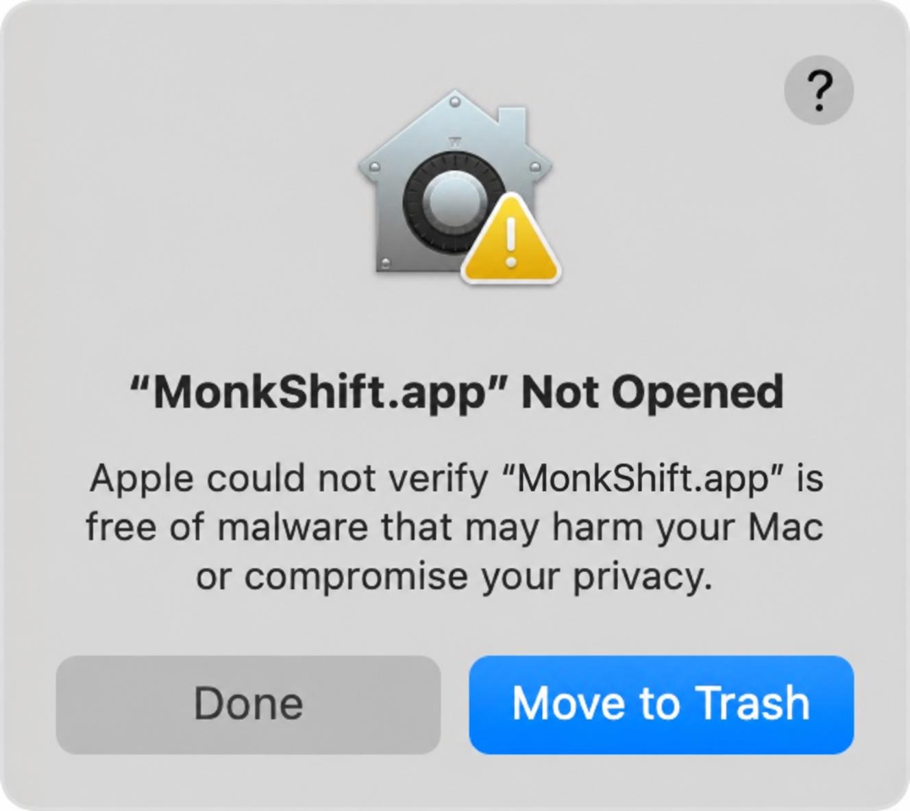

# MonkShift


A minimal native macOS focus utility built with SwiftUI and AppKit for **macOS
14 or later**. MIT licensed, fully offline, with no third-party dependencies,
accounts, analytics or resident helpers.

Monk Mode combines Dock, menu bar, Stage Manager and display preferences with
your chosen window-focus mode, then restores the previous settings when disabled.
Use individual controls or saved profiles from the app window and menu bar.

<p>
  
  
</p>

Fixture previews of the real UI, rendered without changing system settings.
They show layout and example states, not proof of OS effects.
[Automation onboarding](docs/images/permission-light.png).

## Philosophie

Attention is finite. What fills the screen also occupies the mind. MonkShift
reduces visual distractions so one application, and one task, can take the foreground.

Muted colors bring the screen closer to a newspaper than a glossy magazine.
The intention is simple: to make the computer feel like a tool for deliberate
work, with fewer invitations to consume and more room to think.


*Real desktop screenshots before and after Monk Mode.*

## Install

Download the latest **Universal DMG** for Apple Silicon and Intel from
[GitHub Releases](https://github.com/gslava/MonkShift/releases/latest). Open it,
drag **MonkShift.app** onto **Applications**, then eject the image. A ZIP and
SHA-256 checksums are also available. Release notes are included with each release.

Or install through this repository's custom Homebrew tap:

```sh
brew tap gslava/monkshift https://github.com/gslava/MonkShift.git
brew install --cask gslava/monkshift/monkshift
```



The app is **ad-hoc signed and not notarized**. If macOS cannot verify it,
dismiss the alert. If you trust the download, open **System Settings → Privacy &
Security**, click **Open Anyway**, then confirm **Open**. See
[Apple's instructions](https://support.apple.com/en-us/102445).

Homebrew does not launch the app or grant permissions. See
[installation and updates](docs/DISTRIBUTION.md#first-launch-and-updates).

## Permissions and privacy

Install in `/Applications` before granting permissions:

- **Automation:** click **Grant Automation Permission** and allow **System
  Events**. If denied, enable it under System Settings → Privacy & Security →
  Automation → MonkShift, then click **Check Again**. System controls and global
  shortcut actions require this permission.
- **Accessibility:** requested at startup to identify the active window for
  background dimming. Other controls remain usable if denied. After granting it
  under Privacy & Security → Accessibility, press **Refresh**.

Screen Recording and Input Monitoring are not requested; window titles,
screenshots and keystrokes are not read. An ad-hoc signed update may require
permission again. See [permission troubleshooting](docs/USER_GUIDE.md#permissions).

## Controls and status

Every setting is available in the window and menu bar. **Enable Monk Mode**
applies the common settings and the last selected window-focus mode.

| Setting | Effect |
| --- | --- |
| Instant Dock | Removes the Dock's auto-hide delay and transition duration. |
| Hide Dock | Auto-hides the Dock; move to its screen edge to reveal it. |
| Hide menu bar | Auto-hides the menu bar; move to the top edge to reveal it. |
| Stage Manager | Enables Stage Manager; requires “Displays have separate Spaces”. |
| Hide recent apps | Hides the recent-apps strip while Stage Manager is enabled. |
| Show windows one at a time | Shows one app window at a time in Stage Manager. See [Window Focus](#window-focus). |
| Dim background windows | Dims behind the active window at an independent 0–90% intensity. |
| Hide desktop icons and widgets | Hides both while preserving files and widget positions. Clicking the desktop may temporarily reveal them. |
| Reduce Motion | Reduces system and app motion; does not remove every animation. |
| Black wallpaper | Uses a black background on connected displays in the current desktop Space. |
| Grayscale | Applies a grayscale display filter with adjustable intensity. |

Status reflects observed macOS settings. Known external changes update it
automatically; changes without a notification may require returning to the app,
opening its menu or pressing **Refresh**. External changes do not overwrite
saved profiles or restore baselines. There is no periodic background polling.
**Unknown** and **Unavailable** states are shown explicitly; use the information
buttons or **Review Issues…** for details.

Closing the window keeps menu bar controls and shortcuts running. Choose
**Open MonkShift…** from the menu to reopen it; **Quit** exits the app.

### Grayscale intensity

Adjust grayscale from **0–100%** in the window or menu bar; changes apply on
release. The default is **50%**. The menu slider requires grayscale to be on;
the window can save a preferred value while it is off. At 0% the system may
still apply its minimum filter intensity; switch grayscale off to remove it.

<p>
  
  
</p>

Menu control fixtures, shown separately from the surrounding native menu.

### Window Focus

**Show windows one at a time** and **Dim background windows** are mutually
exclusive. One-window mode also enables **Stage Manager** and **Hide recent
apps**. Disabling it or switching to dimming turns **Stage Manager off**,
revealing windows from other apps, and restores recent-apps visibility.
**Restore All** can recover the original Stage Manager state.
Turning both modes off retains the last choice for the next Monk Mode session.

Dimming has a separate **0–90%** slider, defaulting to **50%**, in the window and
menu bar. Both dimming sliders require the effect to be on. At 0% no dimming layer is
drawn. The effect does not intercept clicks or keyboard input. Menus and floating
palettes can remain above it. It pauses when the active window cannot be
identified safely, Accessibility is lost or one-window mode is enabled externally.

<p>
  
  
</p>

<p>
  
  
</p>

Some controls use version-sensitive macOS preferences or private APIs. Reading a
setting back does not prove its visual effect. Mission Control, full-screen and
Stage Manager transitions need live checks on each supported macOS version.
See [detailed behavior and limitations](docs/USER_GUIDE.md) and
[compatibility checks](docs/TESTING.md#background-dimming-manual-checks).

## Monk Mode and restoration

MonkShift saves original settings before changing them:

- **Disable Monk Mode** restores the state saved immediately before that session.
- **Restore All Changes** restores the session, then any earlier individual
  changes. Features that were originally enabled can remain enabled afterward.
- **Quit** keeps current system settings and saved restore records. Dimming stops
  until relaunch because its windows belong to MonkShift. Reopen to restore.

Changes made during a session do not replace its baseline; restoration overwrites
those later edits. Failed restore records remain available for retry. Reconnect
a missing display and retry **Restore All Changes** if necessary. An unreadable
restore file blocks further changes rather than being replaced.

Wallpaper restoration covers saved connected displays and their current desktop
Space; other Spaces, wallpaper schedules and displays added later are not managed.
Keep original wallpaper files available. See [restoration and local data](docs/USER_GUIDE.md#restoration-and-local-data).

## Settings profiles

The **Profile** dropdown and menu bar submenu select and immediately apply a
saved configuration. **Default** initially captures current readable settings
without changing macOS. **New Profile…** creates a named copy; successful checkbox
and preferred-intensity edits autosave to the active profile.

Profiles and selection survive restart, but startup does not automatically apply
a profile. Switching preserves original restore baselines; **Restore All** keeps
saved profiles. External changes and restoration do not overwrite them. Global
shortcuts are shared across profiles. See [profile behavior](docs/USER_GUIDE.md#settings-profiles).

## Global shortcuts

| Action | Default |
| --- | --- |
| Monk Mode / restore previous session | Control + Option + Command + M |
| Stage Manager | Control + Option + Command + S |
| Color Filter | Control + Option + Command + C |
| Hide / show menu bar | Control + Option + Command + B |
| Show windows one at a time | Control + Option + Command + W |
| Dim background windows | Control + Option + Command + D |

Use **Shortcuts… → Edit…** to customize bindings. Invalid or conflicting edits
preserve the previous working shortcut. Shortcuts work while MonkShift is
running, even with its window closed or menu bar hidden. System-reserved
combinations or secure input may prevent delivery.

## Apple Shortcuts

In the macOS **Shortcuts** app, search for **MonkShift** and add **Toggle Monk
Mode**, **Enable Monk Mode** or **Disable Monk Mode**. Actions launch the app if
needed; open the installed app once and grant Automation permission first.
Repeated Enable preserves the session baseline; Disable restores it and leaves
settings unchanged when no session exists. Errors are reported to Shortcuts.
See [setup and behavior](docs/USER_GUIDE.md#apple-shortcuts).

## Build and verify

A standard build requires **full Xcode** for Apple Shortcuts metadata. From the
project directory:

```sh
bash scripts/check.sh
bash scripts/build-app.sh
open build/MonkShift.app
```

The build creates a Universal app in `build/MonkShift.app`. Automated checks use
fake settings and do not change macOS preferences or request permissions.
Render light/dark fixtures with `bash scripts/render-previews.sh`; live OS
behavior and performance require separate manual verification. No fixed RAM
claim has been verified.

- [Development](docs/DEVELOPMENT.md): Xcode setup and local build options.
- [User guide](docs/USER_GUIDE.md): detailed controls, profiles and restoration.
- [Architecture](docs/ARCHITECTURE.md): settings APIs, observation and resource design.
- [Testing](docs/TESTING.md): automated coverage, previews and manual checks.
- [Distribution](docs/DISTRIBUTION.md): packaging, releases, Homebrew and updates.
